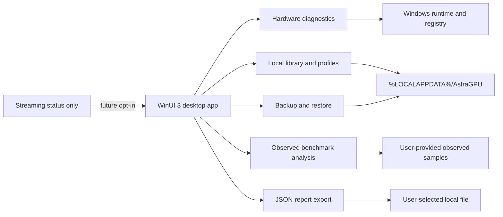

# AstraGPU

[](https://github.com/Emanuelgm98/astragpu/actions/workflows/dotnet.yml) [](LICENSE)

AstraGPU is a local-first Windows companion for transparent hardware diagnostics, a private executable library, conservative session profiles, reversible local backups, and honest frame-time analysis. It is not a universal FPS optimizer and it never fabricates performance results.

> This document describes the implementation on `feature/mvp-local`. It intentionally distinguishes working local behavior from future integrations.

## Architecture



The solution is split into small .NET projects:

| Component | Responsibility |
| --- | --- |
| `AstraGPU.Core` | Shared diagnostic, library, profile, sample, and report models. |
| `AstraGPU.Hardware` | Windows facts collected without elevation; unsupported fields remain unavailable. |
| `AstraGPU.Optimization` | Local `.exe` library and read-only conservative profile catalog. |
| `AstraGPU.Security` | Path validation plus ZIP backup/restore. |
| `AstraGPU.Benchmark` | Percentile calculations from observed frame-time samples and JSON report export. |
| `AstraGPU.Streaming` | Explicit not-configured status; no listener or cloud transport. |
| `AstraGPU.App` | WinUI 3 UI that calls the local services directly. |

## Current status

Implemented and connected to the UI:

- Windows diagnostics for OS, architecture, logical processors, adapter name and VRAM when Windows exposes them through the local registry. Each value includes a status and source/detail; unavailable sensors are not guessed.
- A bounded local diagnostic history keeps the latest 50 user-requested snapshots in `diagnostics-history.json`, with no telemetry or remote upload.
- A private library under `%LOCALAPPDATA%\AstraGPU`. The selected path must exist, end in `.exe`, and begin with the PE `MZ` header. AstraGPU does not launch or execute it.
- Conservative profiles that describe safe options only. They do not change services, registry policy, security software, drivers, firmware, clocks, voltages, or anti-cheat settings.
- ZIP backup and restore actions. Restore validates archive paths and stays within the local data directory.
- Benchmark report export. Empty or incomplete observations remain empty or null; no FPS is generated.
- Offline operation after package restore. No account, telemetry endpoint, remote listener, paid cloud, or AWS integration exists.

Not implemented by design: game launching, automatic FPS capture, overclocking, driver management, DLL injection, security bypasses, cloud streaming, MSI/MSIX installation, and automatic desktop shortcuts.

## Requirements

- Windows 10 version 1809 (build 17763) or later; Windows 11 is recommended.
- .NET 8 SDK.
- Windows App SDK / WinUI 3 tooling and Windows SDK for the desktop project. The app project currently references `Microsoft.WindowsAppSDK` 1.6.250205002 and `Microsoft.Windows.SDK.BuildTools` 10.0.26100.3916.
- Network access is needed only to restore NuGet packages or fetch the repository; runtime features are local.

## Build and test

From the repository root:

```powershell
dotnet restore AstraGPU.sln
dotnet test tests/AstraGPU.Tests/AstraGPU.Tests.csproj -c Release --no-restore
dotnet build src/AstraGPU.App/AstraGPU.App.csproj -c Release --no-restore
```

For a reproducible unpackaged Windows output:

```powershell
./packaging/Publish-Windows.ps1 -Configuration Release
```

The script publishes `artifacts/AstraGPU-win-x64`. It is not an MSI/MSIX installer and requires the matching Windows App SDK runtime. No system-wide installer or shortcut is created.

## Using the application

- **Diagnostics** captures local facts and displays `available` or `unavailable` states with detail. Missing sensors are expected and are not replaced with estimates.
- Each diagnostic capture is also retained locally as an audit history of the latest 50 snapshots; it can be included as the last snapshot in an exported report.
- **Library** opens a Windows file picker and stores validated executable paths only.
- **Profiles** shows the conservative catalog. Applying risky system changes is not supported.
- **Backup** writes a ZIP selected by the user. **Restore** reads a selected ZIP and validates every destination path.
- **Benchmark** currently has no automatic capture adapter. **Export report** produces JSON containing the last diagnostics snapshot and a benchmark summary; without observed samples it contains no numeric FPS result.
- **Streaming** clearly reports that no network service is configured.

## Benchmark honesty

`BenchmarkAnalyzer` accepts `BenchmarkSample` values with positive finite frame times and calculates median, P95, and 1% low FPS only when at least 100 observed samples exist. It does not run games, synthesize samples, or claim a performance improvement. Results depend on the source, scene, resolution, driver, and capture conditions. See [docs/BENCHMARKING.md](docs/BENCHMARKING.md).

## Security and privacy

AstraGPU is designed to run as a standard user. It does not alter antivirus, firewall, anti-cheat, services, drivers, firmware, registry policy, clocks, or voltages. File paths are validated before library and archive operations, archive traversal is rejected, and local reports are written only to the user-selected destination. See [docs/SECURITY.md](docs/SECURITY.md).

No telemetry or cloud backend is present. The library and backup data remain under the local Windows profile unless the user explicitly chooses another report/backup destination.

## Repository guide

- [docs/MANUAL.md](docs/MANUAL.md) — user workflow and publish instructions.
- [docs/ARCHITECTURE.md](docs/ARCHITECTURE.md) — project boundaries and data flow.
- [docs/INSTALLATION.md](docs/INSTALLATION.md) — Windows setup notes.
- [docs/BENCHMARKING.md](docs/BENCHMARKING.md) — observed-sample methodology.
- [docs/SECURITY.md](docs/SECURITY.md) — security boundaries.
- [docs/LICENSING.md](docs/LICENSING.md) — licensing notes.
- [CHANGELOG.md](CHANGELOG.md) — project history.

## Roadmap

1. Add a documented, licensed frame-time import adapter without launching games.
2. Improve Windows hardware inventory with additional OS-supported sources and clear provenance.
3. Add a reviewed packaged distribution only after reproducible signing and runtime verification are available.
4. Design any future LAN streaming as separately authenticated, opt-in, and offline-capable; it is not part of this MVP.

## Contributing

Keep changes local-first and evidence-based. Add tests for safety-sensitive behavior, do not add fabricated benchmark records, and do not introduce privileged or hidden machine changes. See [LICENSE](LICENSE) for the MIT license.
